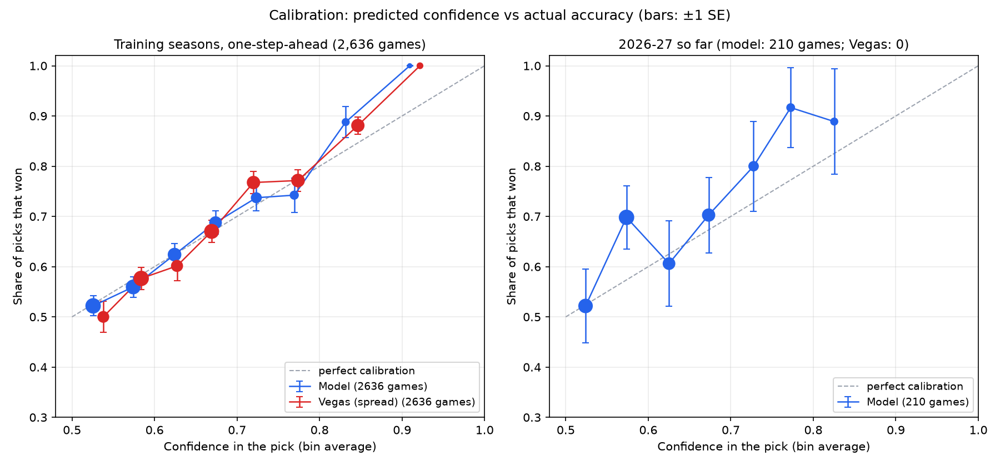

# Accuracy report: the live model vs Vegas and simple baselines

Generated 2026-11-19 by `python code/report.py`. Live model as in `params.py`: exact engine, fitted σ in the update and the simulation, team paces, home-court boost, rest (back-to-backs), 10,000-draw simulation.

## Summary

- **Training seasons (2024-25, 2025-26; 2,636 games, one-step-ahead):** model 62.5% winners, Brier 0.2255; Vegas closing spread 68.9%, Brier 0.1994. Model − Vegas: Brier +0.0261 ± 0.0025 (+10.6 SE), accuracy -6.4 pts ± 0.9 (-7.0 SE). Vegas is better by 2+ SE on winners picked, Brier, log loss, margin MAE, total MAE.
- **2026-27 with closing lines: 0 games so far.** Line collection started on 2026-11-19, after the 210 games logged so far; this comparison grows as `update.py --update` / `lines.py` save lines and the games are played.
- **2026-27, all 210 logged games (no Vegas yet):** model 67.6% winners, Brier 0.2110; home team 51.4%; better record 65.7%.

## Resume bullets

- Built a Bayesian NBA game predictor in Python: Four Factors offense/defense ratings updated game by game with conjugate Normal (Kalman) updates, and a 10,000-draw Monte Carlo game simulation with team pace, home-court and rest effects fitted by one-step-ahead likelihood.
- Backtested one step ahead on 2,636 games (2024-25 and 2025-26): the model picked 62.5% of winners vs 68.9% for Vegas closing lines (Brier 0.2255 vs 0.1994), closing 46% of the Brier gap between always picking the home team and Vegas.
- On the same games the model beat always picking the home team on both winners picked (62.5% vs 55.0%) and Brier (0.2255 vs 0.2475), and was level with picking the team with the better record on Brier (0.2255 vs 0.2266) and trailed it on winners picked (62.5% vs 65.2%).
- Runs live as a daily pipeline (NBA.com data, crash-safe updates, every prediction logged before tip-off): 67.6% of winners and Brier 0.2110 over the first 210 games of 2026-27 (±3.5 pts), vs 51.4% for the home team and 65.7% for the better record.

Every number above is from this report; the training-season numbers are backtests (see the caveats).

## Method

- **Model:** the live settings. Training sample: `train_calibration.py`'s one-step-ahead pass over the 3-year window before 2026-10-03 (2023-10-24 to 2026-06-13): ratings start flat, every game updates them, and each game after the first season (2,636 games) is simulated from the ratings as they stood before it. That pass is the TRAINING update (tau = 0, no season reset), so its ratings never forget: by 2025-26 they weigh a game from 2023-24 as much as last night's. The live 2026-27 pipeline instead resets the stds each season (0.1/√20) and adds drift every game (0.1/30). 2026-27: the logged predictions, each made before the game (`log_pace-home-rest.csv` (210)).
- **Vegas (spread):** P(home wins) = Φ(−spread_home / SD), SD = **13.83 points**, fitted on the 3,956 training games with a line (the RMS of actual home margin + spread; the mean residual is -0.09, i.e. lines are unbiased to within a fraction of a point). No 2026-27 game is used. Margin projection = −spread, total projection = the posted total.
- **Vegas (moneyline, no vig):** the median across books of each book's vig-free home probability (`lines.py`). The Kaggle file's moneylines stop in mid 2022-23, so this exists only for 2026-27 games.
- **Home team:** always the home team, P = 0.549 (home win rate over the 3,956 training games). **Better record:** the team with the better win% in that season before that day (0 games = .500), P = 0.649 (how often that pick won in training, 3,798 games); equal records fall back to the home team.
- **Metrics:** winner accuracy (a 50/50 pick counts half), Brier = mean (P(home) − home won)², log loss (P clipped to [0.0001, 0.9999]), margin / total MAE vs the actual result, calibration in confidence bins. All predictors are scored on the same games. Paired differences are per-game differences vs Vegas (spread), mean ± SE (SD/√n); |z| < 2 is within noise.
- **Data:** Kaggle "NBA Betting Data | October 2007 to June 2026" (`nba_2008-2026.csv`, SHA-256 `729eb2ead85c14af…`), matched to 3,956 of 3,956 training games (100.0%). 2026-27 lines: `data/lines_2026-27.csv`, 4 snapshots of 4 games; the closing line is a game's last snapshot before tip-off.

## Training seasons: 2024-25 and 2025-26 (2,636 games)

| Predictor | Games | Winner accuracy | Brier | Log loss | Margin MAE | Total MAE | Avg confidence |
|---|---:|---:|---:|---:|---:|---:|---:|
| Model | 2636 | 62.5% | 0.2255 | 0.6416 | 11.91 | 15.71 | 62.5% |
| Vegas (spread) | 2636 | 68.9% | 0.1994 | 0.5823 | 10.80 | 14.48 | 68.5% |
| Home team | 2636 | 55.0% | 0.2475 | 0.6882 | – | – | 54.9% |
| Better record | 2636 | 65.2% | 0.2266 | 0.6455 | – | – | 64.5% |

**Paired differences vs Vegas (spread)** (negative Brier / log loss / MAE = better than Vegas):

| vs Vegas (spread) | Accuracy | Brier | Log loss | Margin MAE | Total MAE |
|---|---:|---:|---:|---:|---:|
| Model | -6.4 pts ± 0.9 (-7.0 SE) | +0.0261 ± 0.0025 (+10.6 SE) | +0.0594 ± 0.0055 (+10.8 SE) | +1.11 ± 0.10 (+11.3 SE) | +1.23 ± 0.14 (+8.7 SE) |
| Home team | -13.9 pts ± 1.2 (-11.6 SE) | +0.0481 ± 0.0032 (+14.8 SE) | +0.1059 ± 0.0072 (+14.6 SE) | – | – |
| Better record | -3.7 pts ± 0.8 (-4.4 SE) | +0.0271 ± 0.0026 (+10.3 SE) | +0.0632 ± 0.0059 (+10.8 SE) | – | – |

**Model vs the baselines** (positive accuracy / negative Brier and log loss = the model is better):

| Model − baseline | Accuracy | Brier | Log loss |
|---|---:|---:|---:|
| Home team | +7.5 pts ± 1.2 (+6.2 SE) | -0.0220 ± 0.0026 (-8.5 SE) | -0.0466 ± 0.0056 (-8.4 SE) |
| Better record | -2.7 pts ± 1.0 (-2.7 SE) | -0.0010 ± 0.0027 (-0.4 SE) | -0.0039 ± 0.0057 (-0.7 SE) |

**Disagreements:** the model and Vegas picked different winners in 603 games (22.9%); the model was right in 217 (36.0%), Vegas in 386. (0 pick'em lines had no Vegas pick.) On average the model's margin is 4.42 pts and its total 6.47 pts from the Vegas numbers.

**By season** (same games, split):

| Season | Games | Model acc. | Vegas acc. | Model Brier | Vegas Brier | Brier diff (model − Vegas) |
|---|---:|---:|---:|---:|---:|---:|
| 2024-25 | 1314 | 63.8% | 68.8% | 0.2198 | 0.2012 | +0.0186 ± 0.0030 (+6.3 SE) |
| 2025-26 | 1322 | 61.1% | 69.0% | 0.2312 | 0.1977 | +0.0336 ± 0.0039 (+8.5 SE) |

**Calibration**

| Predictor | Confidence bin | Games | Avg confidence | Accuracy | Accuracy − confidence (pts) |
|---|---:|---:|---:|---:|---:|
| Model | 50–55% | 639 | 52.6% | 52.2% | -0.4 |
| Model | 55–60% | 579 | 57.4% | 56.0% | -1.5 |
| Model | 60–65% | 476 | 62.4% | 62.4% | -0.0 |
| Model | 65–70% | 397 | 67.4% | 68.8% | +1.4 |
| Model | 70–75% | 274 | 72.3% | 73.7% | +1.4 |
| Model | 75–80% | 163 | 76.9% | 74.2% | -2.7 |
| Model | 80–90% | 107 | 83.2% | 88.8% | +5.6 |
| Model | 90–100% | 1 | 90.9% | 100.0% | +9.1 |
| Vegas (spread) | 50–55% | 264 | 53.8% | 50.0% | -3.8 |
| Vegas (spread) | 55–60% | 503 | 58.4% | 57.7% | -0.7 |
| Vegas (spread) | 60–65% | 276 | 62.7% | 60.1% | -2.6 |
| Vegas (spread) | 65–70% | 470 | 66.9% | 67.0% | +0.1 |
| Vegas (spread) | 70–75% | 357 | 72.0% | 76.8% | +4.8 |
| Vegas (spread) | 75–80% | 372 | 77.4% | 77.2% | -0.2 |
| Vegas (spread) | 80–90% | 353 | 84.6% | 88.1% | +3.5 |
| Vegas (spread) | 90–100% | 41 | 92.2% | 100.0% | +7.8 |

## 2026-27 season

### With Vegas closing lines (0 games)

No 2026-27 game has both a prediction and a closing line yet. Lines are saved from 2026-11-19 on (each `update.py --update` and `python code/lines.py` run); the games enter the prediction log when `--update` applies them, so this section fills in over the season. Re-run `python code/report.py` to update it.

### All logged games, model vs simple baselines (210 games, no Vegas)

| Predictor | Games | Winner accuracy | Brier | Log loss | Margin MAE | Total MAE | Avg confidence |
|---|---:|---:|---:|---:|---:|---:|---:|
| Model | 210 | 67.6% | 0.2110 | 0.6109 | 11.96 | 14.82 | 62.5% |
| Home team | 210 | 51.4% | 0.2510 | 0.6952 | – | – | 54.9% |
| Better record | 210 | 65.7% | 0.2224 | 0.6367 | – | – | 63.1% |

| Model − baseline | Accuracy | Brier | Log loss |
|---|---:|---:|---:|
| Home team | +16.2 pts ± 4.3 (+3.7 SE) | -0.0400 ± 0.0087 (-4.6 SE) | -0.0842 ± 0.0188 (-4.5 SE) |
| Better record | +1.9 pts ± 3.5 (+0.5 SE) | -0.0114 ± 0.0090 (-1.3 SE) | -0.0258 ± 0.0191 (-1.4 SE) |

| Predictor | Confidence bin | Games | Avg confidence | Accuracy | Accuracy − confidence (pts) |
|---|---:|---:|---:|---:|---:|
| Model | 50–55% | 46 | 52.4% | 52.2% | -0.2 |
| Model | 55–60% | 53 | 57.4% | 69.8% | +12.4 |
| Model | 60–65% | 33 | 62.5% | 60.6% | -1.9 |
| Model | 65–70% | 37 | 67.3% | 70.3% | +3.0 |
| Model | 70–75% | 20 | 72.8% | 80.0% | +7.2 |
| Model | 75–80% | 12 | 77.3% | 91.7% | +14.4 |
| Model | 80–90% | 9 | 82.5% | 88.9% | +6.4 |

With 210 games, one standard error of the accuracy is about 3.5 points.

## Caveats

- **The training sample is a backtest, not a forecast.** Each prediction uses only earlier games for the team ratings, but the model's constants (game noise σ, home boost, rest effect, pace noise, points formula) were fitted on these same three seasons, which flatters the model a little. The Vegas SD (one number) was fitted on them too. 2026-27 is the only true out-of-sample test.
- **The backtest's ratings don't adapt within a season the way the live model's do** (training pass: tau = 0, no season reset; see Method). That may understate the live model: in the backtest it trails the better-record baseline on winners picked, and its Brier gap to Vegas grows from 2024-25 to 2025-26 (+0.0186 → +0.0336) as the ratings get stiffer. A backtest with the live in-season procedure (season reset + drift) would be the fairer test, but it isn't what this report runs.
- **The first training season is burn-in** (ratings start flat), so it isn't scored.
- **Kaggle lines:** the dataset gives one spread and total per game and doesn't say exactly when they were taken; treat them as closing or near-closing lines.
- **2026-27 "closing" lines** are the last snapshot before tip-off, which can be hours before the true close when lines were only fetched in the morning (median shown above).
- **The 2026-27 season so far is small.** Its first 210 games' accuracy was about 2 SE above what their own margin errors predict (CLAUDE.md, Phase 7), so expect it to drift down.
